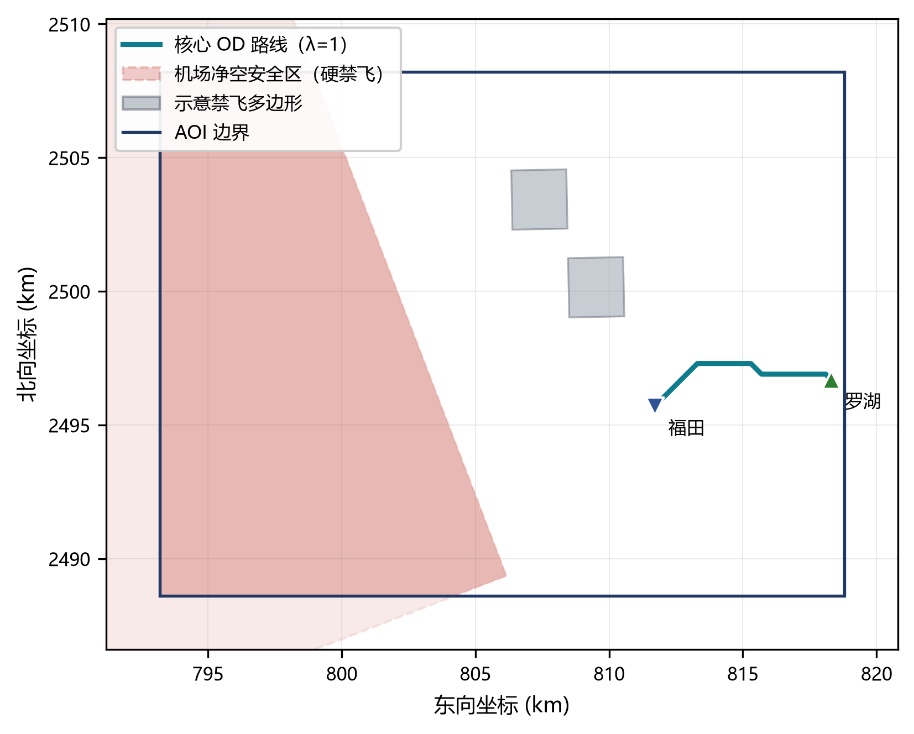
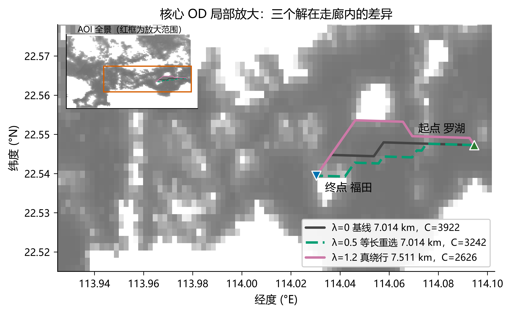
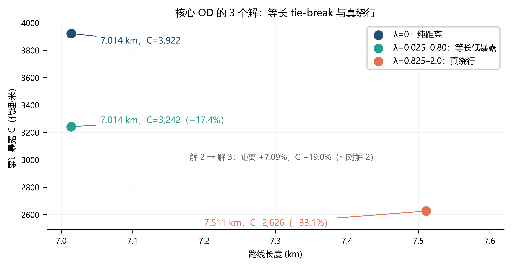

%% 文档标题 低空航路规划：把「距离—人口暴露」权衡做成可复现原型

%% 副标题 弋昊阳
%% 普通 中国民航大学 交通管理学院
%% 普通 College of Air Traffic Management, Civil Aviation University of China
%% 普通 联系邮箱：18778383063@163.com
%% 普通 申请作品集 v1.0｜2026-11-26｜共 4 页
%% 普通 方法演示与可复现性验证，不构成适航审定、运行许可或合规判断，也不判断具体飞行是否获批。

%% 摘要标题 摘要

%% 摘要 低空物流航线不能只按距离最短来选：地面人口密度不同，同样的坠落后果不同。本文在深圳中西部约 25×19 km 范围内建立 200 m 网格（128×98），用 WorldPop 2020 人口栅格构造「人口暴露代理值」，叠加机场净空安全区与两个示意禁飞多边形作为硬约束，比较「最短可行路线」与「低暴露路线」。核心 OD（罗湖—福田，7.01 km）在 λ=1 时多走 **7.09%** 距离、累计暴露下降 **33.05%**；其中 17.4 个百分点来自等长重选，19.0 个百分点来自真绕行，两段不能相加。81 档 λ 只产生 3 个不同解。结果对网格分辨率、起点偏移、遮蔽系数、高度层与安全区尺寸做了敏感性检查。边界：WorldPop 是建模估计，禁飞区为公开资料近似，结论只做相对比较。

%% 关键词 关键词：低空航路；人口暴露代理；距离—暴露权衡；可复现原型；深圳

# 1. 问题与贡献

%% 正文 低空物流航线规划通常以距离或时间最短为目标，但城市地面人口密度差异很大：同一条 7 km 航线，飞过高层住宅区与飞过水域，地面暴露完全不同。本文把这个问题收窄成一个可计算、可检验的工程问题：**在固定硬空域约束下，绕行多少距离能换来多少人口暴露下降？**

%% 正文 贡献有三点。第一，把「人口暴露」做成与路径代价可分离的栅格量，路线代价写成「长度 ×（1 + λ × 暴露）」，λ=0 即纯距离。第二，把机场净空安全区按公开通告尺寸建成硬约束，并如实记录「4 组机场向 OD 不可达」这一反例。第三，用 81 档 λ 扫描识别出「等长重选」与「真绕行」两段不同机制，而不是把两者混成一个百分比。

%% 正文 与已有工作相比，本文不追求新的风险模型，而是回答一个更窄的问题：在固定硬约束与公开人口数据下，距离与暴露如何互换，以及这种互换对参数是否稳健。地面风险模型通常拆成「暴露人口 × 撞击概率 × 致死率」三部分 [@washington2017]，本文只取其中的暴露人口一项；遮蔽、高度等乘子只做情景，不声称是 SORA 定量评估 [@jarus2024]。

# 2. 方法与数据

%% 正文 研究区为深圳中西部 113.85–114.10°E、22.48–22.65°N，投影 EPSG:32649，200 m 网格共 12,544 格。人口数据用 WorldPop 2020 中国 100 m 约束版聚合到 200 m 格 [@tatem2017]；机场净空安全区按深公规〔2017〕3 号「跑道中线两侧各 10 km、端外 20 km」建模 [@szgov2017]，与梧桐山、深圳水库两个示意多边形一起作硬禁飞，共 4,982 格（39.72%）不可通行。图 1 给出空域约束与核心 OD 的位置关系。

{width=7.8cm}

%% 图片题注 图 1　空域约束总览：机场净空安全区、示意禁飞多边形与核心 OD

%% 表格题注 表 1　核心实验设定

| 项目 | 取值 |
|---|---|
| 网格 / 投影 | 200 m，128×98 = 12,544 格，EPSG:32649 |
| 高度层 | 主实验 60 m；90 / 120 m 仅作情景 |
| 人口数据 | WorldPop 2020，100 m 约束版聚合 |
| 空域约束 | 机场净空安全区 + 2 个示意多边形，硬禁飞 |
| 核心 OD | 罗湖—福田，7.014 km |
| 路线算法 | 8 邻接 Dijkstra；对角要求两正交邻格畅通 |

%% 正文 暴露定义分三步：先把格内人口按 p95 归一化并截断到 1，得到 e∈[0,1]；再乘严重度、遮蔽与高度因子；最后沿航线对「边长 × 两端平均暴露」求和，得到累计暴露 C（单位「代理·米」）。E=C/L 为平均暴露强度，用于跨路线比较。本文不使用「风险」「安全」做结论性表述：它没有失效概率、坠落轨迹与伤亡换算。

%% 正文 路线搜索在 8 邻接网格上做 Dijkstra：直边 200 m，斜边 200√2 m；对角移动要求两个正交邻格都畅通，避免「贴着禁飞区切角」。边权为「长度 ×（1 + λ × 暴露）」，λ=0 退化为最短路。λ 扫描范围 0–2、步长 0.025，共 81 档；另外 5 组走廊外 OD 用 0.05 步长作小规模扩展。

# 3. 结果：三个解，而不是一个百分比

%% 正文 核心 OD 的 81 档 λ 只产生 3 个不同解。λ=0 为纯距离基线，7.014 km，C=3,922；λ=0.025–0.80 为「等长重选」：长度完全不变，但在等长路径里挑累计暴露更低的一条，C 降到 3,242（−17.4%）；λ≥0.825 才出现真正的几何绕行：7.511 km（+7.09%），C 再降到 2,626（相对前一解 −19.0%）。两段机制不同，不能相加成「绕行换安全」。

%% 表格题注 表 2　核心 OD 的三个解

| 解 | λ 区间 | 长度 km | C（代理·米） | 相对变化 |
|---|---|---|---|---|
| 纯距离基线 | 0 | 7.014 | 3,922 | — |
| 等长低暴露 | 0.025–0.80 | 7.014 | 3,242 | −17.4%（长度不变） |
| 真绕行 | 0.825–2.0 | 7.511 | 2,626 | +7.09% 距离，再 −19.0% |

{width=10.6cm}

%% 图片题注 图 2　核心 OD 局部放大：三个解在走廊内的差异（左上为 AOI 全景与放大范围）

%% 正文 图 2 是本文最核心的一张图：灰实线贴着最短路径，绿虚线在等长前提下换到人口更低的格子，品红实线为了避开高暴露街区向北绕行。三条线的差异在局部放大后才看得清，这也说明 200 m 网格下「低暴露」首先体现为同长度重选，其次才是绕行。

{width=10.2cm}

%% 图片题注 图 3　核心 OD 的 3 个解：等长 tie-break 与真绕行

## 3.1 五组走廊外 OD：机制可复现，幅度不同

%% 正文 把同一套方法套到 5 组走廊外 OD，结果分成三类：真绕行（龙华—福田、福田—罗湖）、等长重选（北站—福田、布吉—罗湖）与核心 OD。最明显的是龙华—福田：多走 8.51% 距离，C 下降 35.38%；福田—罗湖多走 7.09%，C 下降 28.05%。北站—福田与布吉—罗湖只发生等长重选，长度不变、C 分别下降 1.63% 与 20.25%。这说明「距离—暴露」互换不是核心 OD 的偶然，但绕行幅度取决于沿线人口分布。

%% 表格题注 表 3　五组走廊外 OD 的 λ=1 结果

| OD | 长度变化 | C 变化 | 机制 |
|---|---|---|---|
| 龙华—福田 | +8.51% | −35.38% | 真绕行 |
| 福田—罗湖 | +7.09% | −28.05% | 真绕行 |
| 北站—福田 | 0% | −1.63% | 等长重选 |
| 布吉—罗湖 | 0% | −20.25% | 等长重选 |
| 罗湖—福田（核心） | 0% | −1.4% | 等长重选 |

# 4. 敏感性：哪些结论稳，哪些不稳

%% 表格题注 表 4　主要敏感性检查（核心 OD，60 m）

| 检查 | 设置 | 结果 |
|---|---|---|
| 网格分辨率 | 100 / 200 / 400 m | 长度 +5.8% / 基准 / 0%；400 m 下 C 仅 −13.8%，不能当主实验 |
| 起点偏移 | ±0.5 格 × 9 位置 | \|ΔC\| 最大 1.56% / 3.57% / 20.83% |
| 遮蔽系数 | 0.2 / 0.3 / 0.4 | 首次真绕行 λ = 0.725 / 0.825 / 0.950 |
| 归一化分位 | p90 / p95 / p99 | 阈值 0.950 / 0.825 / 0.750，3 解不变 |
| 高度层 | 60 / 90 / 120 m | 阈值 0.825 / 0.950 / 1.175，路线几何不变 |
| 安全区尺寸 | ×0.5 / ×1.0 / ×1.5 | 不可通行 9.3% / 39.7% / 60.7%，机场向可达 1/0/0 |

%% 正文 两条稳定结论：一是「等长重选」在分辨率、起点偏移、遮蔽与分位数变化下都存在，方向一致；二是高度层与安全区尺寸只改变阈值或可达性，不改变核心 OD 的路线几何。两条不稳的结论：400 m 粗网格会抹掉暴露差异，只能作稳健性对照；机场向 OD 的可达性高度依赖安全区尺寸，因此本文只报告「在本模型规则下不可达」，不外推到真实空域政策。

%% 正文 需要特别说明：遮蔽 0.30、高度因子 0.85/0.70 都是工程假设，不是实测系数；它们只改变 λ 的刻度（阈值随乘子平移），不改变「等长重选 + 真绕行」的机制。把它们写成情景而不是结论，是本文与 SORA 定量评估的边界。

# 5. 边界与可复现

%% 正文 **边界**：人口是建模估计而非普查；禁飞区是公开资料近似，不是官方边界；主实验只有 60 m 单层；主区/副区未细分；端点吸附超过 300 m 判不可达是模型规则；不做 SORA 定量评估、不做动态空域、气象与通信干扰；不判断具体飞行是否获批。

%% 正文 **可复现**：代码与处理后数据在 GitHub（tag v1.0），一键命令 `python -m src.cli all`（real 模式 12 步、约 124 s）；`pytest` 69 项通过；所有结果 CSV 由脚本重新生成，报告不手改数字。运行日志记录输入人口栅格路径、字节数、SHA256 与代码 commit，送审包附 `SHA256SUMS.txt`。

%% 正文 **个人贡献**：问题定义、实验设计、结果核对与报告写作由本人完成；代码与初稿在 AI 辅助下完成，并经本人逐项核对。可核对证据：commit 历史、`docs/decisions.md` 的 20 余条决策记录、`docs/review_fixes.md` 的外部审稿对照表。本原型的适用边界是方法演示、课程/面试与复现基线，不用于适航审定、合规判断或真实飞行决策。

%% 参考文献标题 参考文献
